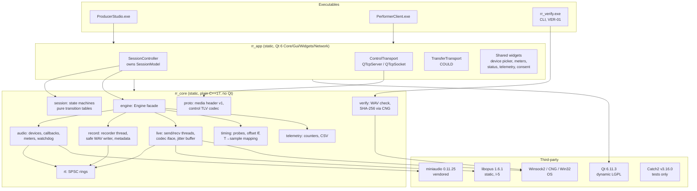
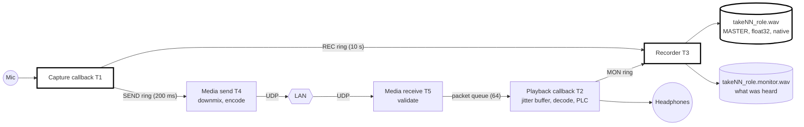
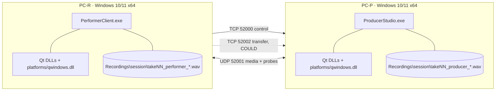

# Component Diagrams

**Stage 2 · 11 October 2026.** These are Mermaid diagrams made for engineering
review. They are *not* the hand-drawn report figures; the proposal template's
rule on AI-made figures applies to Figures 1–5 of the report.

## 1. Build targets and dependencies (ADR-001)

## 2. The two audio paths on one PC (master path independent of the live path)

No arrow leads from the network side (T4, T5, T2) into `WAV`. The only data
going *into* the recorder from the live side is the separately named monitor
file (REC-11). Concealment exists only in T2.

## 3. Separation of concerns (the eight areas the stage brief requires)

| # | Concern | Component(s) | Thread(s) | Qt? |
|---|---|---|---|---|
| 1 | UI / presentation | `rr_app` widgets, role windows | T8 | Yes |
| 2 | Session and state coordination | `SessionController` + `rr_core/session` tables | T7 | Controller yes, tables no |
| 3 | Audio capture and playback | `rr_core/audio` | T1, T2, T6 (watchdog) | No |
| 4 | Local recording and file finalisation | `rr_core/record` | T3 | No |
| 5 | Live encode/send, receive/decode/playback | `rr_core/live` | T4, T5, T2 | No |
| 6 | Control messages and acknowledgements | `rr_core/proto` (codec) + `ControlTransport` | T7 | Transport yes |
| 7 | Timing measurement and telemetry | `rr_core/timing`, `rr_core/telemetry` | T4/T5 (probes), T3 (mapping), T6 (CSV) | No |
| 8 | Post-session take transfer and integrity check | `TransferTransport` + `rr_core/verify` | T9, `rr_verify` | Transport yes |

## 4. Deployment on the two PCs

Each deployment folder contains:
- the exe and `windeployqt` output;
- `rr_verify.exe`;
- `LICENSES/` and `NOTICE.txt` (ADR-004).

The `vc_redist.x64.exe` installer runs once on each PC (ADR-002). The
recordings folder defaults to `%USERPROFILE%\Music\RemoteRecording\` (prov.).
