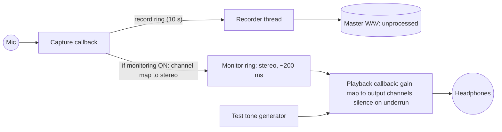

# Local Playback, Monitoring and Audio Diagnostics (Stage 5)

**Status:** implemented in `libs/audio` (`monitor_bus.*`, `audio_engine.*`, `EngineReport.cpp`)
and `libs/ui_common/src/audio_panel.*`. The Qt-free parts are unit-tested and were run on real
WASAPI devices through `rr_audio_probe`. The Qt panel has not been compiled
(no Qt on the development PC).

## 1. Signal paths

The record ring and the monitor ring are **separate buffers**. Nothing on the monitor side
(gain, channel mapping, resampling, underrun silence, latency trims) can reach the master file.
The record path code is unchanged from Stage 4.

## 2. Devices
- **Input:** explicit device ID, native rate and channels, no conversion (ADR-003).
- **Output:** explicit device ID, `noAutoStreamRouting`, native channel count. It renders at the **capture rate** so the monitor needs no resampling by us. If the output device runs at another rate, **miniaudio resamples the monitor signal only**; the output format line and the report state this.
- **Reopening the input while the output runs:** both devices are stopped, the monitor bus is recreated only if the rate changed, then both restart. This was observed on real devices: 2 counted underruns in the transition, 0 faults (§6).
- **Output fault** (unplugged or disabled): monitoring stops, the UI says so, and **recording continues unaffected**.

## 3. What differs between the saved master and what you hear

| Step | Master WAV | Monitor (headphones) |
|---|---|---|
| Sample format | float32 as delivered by WASAPI shared mode | float32 |
| Sample rate | device native (48 kHz required) | capture rate; resampled by miniaudio **only if** the output device rate differs (stated in UI and report) |
| Channels | device native (1–8) | input → stereo (1 ch: L=R; 2 ch: copy; >2 ch: first two) → output (1 ch: average of L and R; 2 ch: copy; >2 ch: L/R, others silent) |
| Gain | none | monitor gain −40…+6 dB in the UI (0 dB default; probe −60…+12) |
| Noise suppression / AGC / compression / limiting | **none** | **none** |
| Gaps | ring overrun → silence inserted **and recorded in the JSON** | underrun → silence (counted); buffer full → block not heard (counted) |
| Latency handling | none (the timeline is preserved) | backlog dropped at each (re)start ("start trim"); persistently excess buffer trimmed ("drift trim"); both counted |
| Added delay | — | monitor buffer target 20 ms + both devices' buffering: an **estimate, not a measurement** |

Windows itself may process the captured stream (driver "enhancements"). The app cannot
see that, and it applies equally to master and monitor. The report says so.

## 4. Monitor buffer policy (`MonitorBus`)
| Parameter | Default (prov.) |
|---|---|
| Target fill before (re)starting playback | 20 ms (960 frames at 48 kHz) |
| Capacity | 200 ms requested, rounded up to a power of two (reported: 341 ms at 48 kHz stereo) |
| Underrun | rest of the block is silent, counted; playback waits for the target again |
| Start trim | at each (re)start, anything above the target is dropped (counted as frames) |
| Drift trim | fill above target + 4 output blocks for 50 consecutive renders → drop to target (counted) |
| Overflow | capture block not written (counted); can only happen if the output stalls |

## 5. Counters and their exact meaning (UI, log, report)

| Name | Meaning | Thread that writes it |
|---|---|---|
| peak / RMS (per channel) | max \|x\| and √(mean x²) over each UI interval (≈50 ms). The three values are reset with separate atomic exchanges, so they are meter values, not a measurement instrument. | capture callback |
| CLIP | ≥ 1 sample with \|x\| ≥ 0.999 in the interval; indicator held 2 s | capture callback |
| record ring fill / max / capacity | frames waiting for the recorder thread, after the latest callback | capture callback |
| record ring overruns | blocks dropped because the record ring was full (gaps in a take) | capture callback |
| timing anomalies | input callback arrived > 3× its duration (and > 20 ms) after the previous one. A **hint** of a stall, not proof of loss. | capture callback |
| longest input / output callback | max time spent inside our callback code | both callbacks |
| monitor fill / max | frames buffered for playback after the latest render | playback callback |
| monitor underruns / overflows / start-trim frames / drift trims | see §4 | playback / capture callback |
| device opens / faults | opens since app start; faults = miniaudio `stopped` we did not cause, or `rerouted` | control thread / miniaudio notification thread |

**Not measured:** acoustic or end-to-end monitor latency, and the real device latency. The
"reported device buffering" is the configured period × periods. Measuring true latency needs
an electrical loopback and impulse timing, which is planned for the measurement stage
(LATER-10).

## 6. Real-time and UI rules
- `push_capture()` and `render()` use only preallocated buffers (`kMaxBlockFrames` chunks), atomics and bounded loops. They mark their thread real-time, so the logger refuses to log from them. There are no locks, file I/O or UI calls.
- The UI reads only atomics, on a 20 Hz `QTimer` on the UI thread. It never waits for an audio thread.
- Problems are logged from the UI thread, at most once per second per kind, as deltas of the counters. The audio threads never log.

## 7. Diagnostic report
- **Diagnostics → "Export diagnostic report (JSON)…"** writes `rr_diagnostics_<role>_<utc>.json` (schema `rr.diagnostics.v1`) containing:
  - build, platform and configuration;
  - logger statistics;
  - the audio snapshot from `engine_report_json()`;
  - the recent log records.
- **Without the GUI:** `rr_audio_probe --monitor <s>` prints the same audio snapshot at the end of its run.
