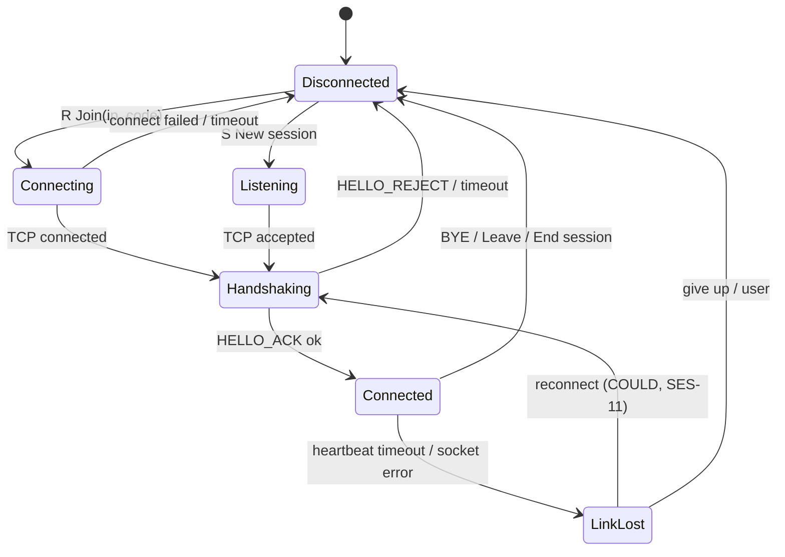
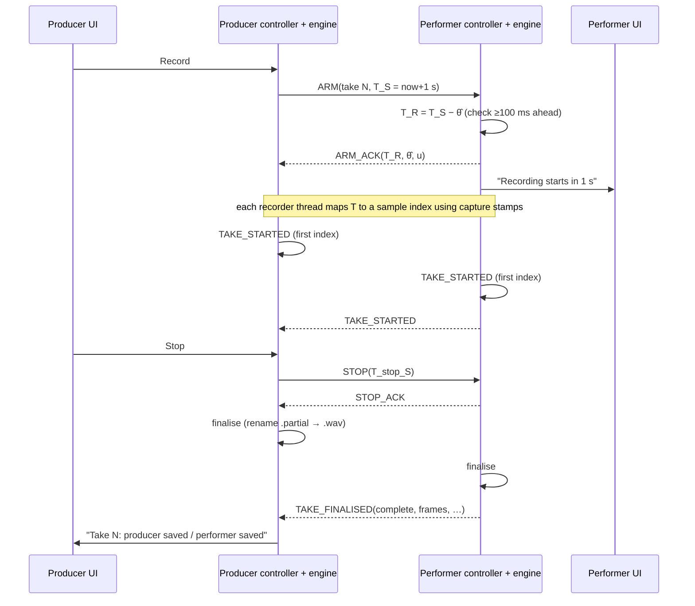

# Session State Machine

**Stage 2 · 11 October 2026 · draft for review.** Traces: SES-01…11, STA-01/02/04/05, ERR-02/03/05/06, UC-01…UC-10.
Message names and codes: [PROTOCOL_OVERVIEW.md](PROTOCOL_OVERVIEW.md).

## 1. Design rules
1. **One source of truth per app:** a `SessionModel` owned by the `SessionController` on the **control thread**. Windows never keep their own `isRecording`-style booleans. They render read-only `SessionSnapshot` copies sent by signal, and they send *commands*.
2. **Two separate machines** instead of one combined one:
   - **Link** (is the peer reachable?);
   - **Session/take** (where are we in a take?).

   The take must be able to keep `Recording` while the link is `Lost` (ERR-03). A single combined machine would need every link × take combination.
3. Transitions are a **pure function** in `rr_core`: `next(state, event, guards) → (state', actions[])`. Actions are side effects (send a message, tell the engine, start a timer) carried out by the controller. The tables below *are* the unit-test specification (ADR-015).
4. **Any event not listed for a state is invalid.** It is ignored, counted, logged with state and event, and fails a unit-test assertion. It never changes state.

## 2. Link machine (both apps)

| From | Event | Guard | To | Actions |
|---|---|---|---|---|
| Disconnected | `UserNewSession` (S) | devices chosen | Listening | create session_id + pairing code, listen on TCP |
| Disconnected | `UserJoin(ip, code)` (R) | — | Connecting | TCP connect, start 5 s timer |
| Connecting | `TcpConnected` | — | Handshaking | send HELLO, start 3 s timer |
| Connecting | `TcpFailed` / `Timeout` | — | Disconnected | show the specific error (SES-03) |
| Listening | `TcpAccepted` | no performer yet | Handshaking | start 3 s HELLO timer |
| Listening | `TcpAccepted` | performer already paired | Listening | reply HELLO_REJECT `E_SESSION_FULL`, close |
| Handshaking | `HelloOk` | versions and code valid | Connected | (S) send HELLO_ACK. Start heartbeat and UDP probes. |
| Handshaking | `HelloBad(code)` | — | Disconnected (R) / Listening (S) | send or show HELLO_REJECT with its reason. S counts failed attempts (5 → new code required). |
| Handshaking | `Timeout` | — | Disconnected (R) / Listening (S) | show "No response" |
| Connected | `HeartbeatTimeout` / `SocketError` | — | LinkLost | show "Connection lost" (STA-02). Tell the session machine `LinkLost`. |
| Connected | `ByeReceived` / `UserLeave` / `UserEndSession` | — | Disconnected (R) / Listening (S) | send BYE and END_OF_STREAM. Tell the session machine `PeerGone`. |
| LinkLost | `Reconnected` (COULD) | same session_id | Handshaking | — |
| LinkLost | `UserLeave` / `UserEndSession` | — | Disconnected / Listening | — |

## 3. Session/take machine

### 3.1 States
| State | Meaning | Is a file open? |
|---|---|---|
| **NotReady** | Something is missing: device, rate, disk, consent, peer or media path | No |
| **Ready** | All readiness conditions hold (§3.2) | No |
| **Armed** | S: ARM sent, waiting for the ACK. R: ARM received and checked, ACK sent. | No |
| **Scheduled** | ACK done. Both wait for start time T. The recorder knows T. | `.partial` opened just before T |
| **Recording** | Writing master samples from the sample mapped to T | Yes |
| **Stopping** | Stop time known. Writing continues until the mapped stop sample. | Yes |
| **Finalising** | Header patch, flush, rename, metadata. S also waits for the peer's TAKE_FINALISED. | Closing |
| **Completed** | *Short-lived.* Results stored in the take list, then the readiness check runs again. | No |
| **Error** | A fault outside a take that needs recovery (for example the audio engine failed to start) | No |
| **Recovery** | Re-open devices and reset the engine | No |
| **Closed** | App shutdown finished (terminal) | No |

### 3.2 Readiness guard `ready()`
- **Local:** capture and playback devices open; native rate = 48 000 Hz; disk space at least REC-09's requirement; consent given (STA-03).
- **Producer additionally:** Link = Connected; peer STATUS says ready; `media_path_ok` (UDP probes answered both ways in the last 2 s).
- **Performer additionally:** Link = Connected; `media_path_ok`.

### 3.3 Producer (S) transitions

| From | Event | Guard | To | Actions |
|---|---|---|---|---|
| NotReady | `ReadinessChanged` | `ready()` | Ready | enable Record |
| Ready | `ReadinessChanged` | `!ready()` | NotReady | disable Record, show the reasons |
| Ready | `UserRecord` | — | Armed | take_id = next; T = now + lead; send ARM; deadline T − 100 ms |
| Armed | `ArmAck(take_id)` | before the deadline | Scheduled | engine `scheduleStart(take_id, T)` |
| Armed | `ArmNack(code)` | — | Ready/NotReady | show the reason. Take not created. |
| Armed | `ArmDeadline` | — | Ready/NotReady | send CANCEL `E_TIMEOUT`. Show "Performer did not confirm". |
| Armed, Scheduled | `LinkLost` | — | NotReady | send CANCEL when possible. Engine `cancel(take_id)` → status `cancelled`. |
| Scheduled | `EngineTakeStarted` | — | Recording | show REC (STA-01), log TAKE_STARTED, send TAKE_STARTED |
| Recording | `UserStop` | — | Stopping | T_stop = now + 300 ms; send STOP; engine `scheduleStop(T_stop)` |
| Recording | `PeerLocalStop(reason)` | — | Recording | show "Performer stopped: reason". The producer keeps recording until the user presses Stop. |
| Recording | `LinkLost` | — | Recording | show "Connection lost, still recording". Peer status = UNKNOWN. |
| Recording, Stopping | `DeviceLost` / `DiskError` | — | Finalising | engine finalises as `incomplete_device` / `incomplete_disk`; send LOCAL_STOP |
| Recording | `SafetyLimit` | — | Stopping | same as UserStop, with reason `E_SAFETY_LIMIT` |
| Stopping | `EngineStopped` | — | Finalising | engine finalise; start the 10 s peer-report timer |
| Finalising | `LocalFinalised(status)` ∧ `PeerFinalised(status)` (either order) | — | Completed | record both statuses |
| Finalising | `PeerReportTimeout` | own take finalised | Completed | peer status = **UNKNOWN**, never "Saved" (SES-06) |
| Completed | (automatic) | — | Ready/NotReady | re-check `ready()` |
| any except Closed | `UserClose` | Recording/Stopping | (same) | ask "A take is recording. Stop, save and quit?" |
| any except Closed | `UserCloseConfirmed` | — | Stopping → Finalising → Closed | stop with reason `E_SHUTDOWN` (`complete_shutdown`), send BYE, shut down in order (THREADING §6) |
| NotReady, Ready | `EngineFault` | — | Error | show the error |
| Error | `UserRetry` | — | Recovery | re-open devices and restart the engine |
| Recovery | `RecoveryDone(ok)` | — | NotReady | — |
| Recovery | `RecoveryDone(fail)` | — | Error | — |

### 3.4 Performer (R) transitions

| From | Event | Guard | To | Actions |
|---|---|---|---|---|
| NotReady | `ReadinessChanged` | `ready()` | Ready | send STATUS(ready) |
| Ready | `ReadinessChanged` | `!ready()` | NotReady | send STATUS(not ready, reason) |
| Ready | `ArmReceived(take_id, T_S)` | T_R = T_S − θ̂ is at least 100 ms ahead; take_id unused | Armed → Scheduled | send ARM_ACK(T_R, θ̂, u); engine `scheduleStart(take_id, T_R)`; show "Recording starts in 1 s" (STA-04) |
| Ready | `ArmReceived` | guard fails | Ready | send ARM_NACK (`E_ARM_TOO_LATE` / `E_TAKE_ID_CONFLICT`) |
| NotReady | `ArmReceived` | — | NotReady | send ARM_NACK `E_NOT_READY` / `E_NO_CONSENT` |
| Scheduled | `CancelReceived` | — | Ready/NotReady | engine `cancel` → `cancelled` |
| Scheduled | `LinkLost` | — | NotReady | engine `cancel`. **No recording starts without a live link at T.** |
| Scheduled | `EngineTakeStarted` | — | Recording | show REC; send TAKE_STARTED |
| Recording | `StopReceived(T_stop_S)` | — | Stopping | send STOP_ACK; engine `scheduleStop(T_stop_S − θ̂)` |
| Recording | `UserStopAndSave` / `SafetyLimit` | — | Stopping | engine stops now; send LOCAL_STOP(reason) when the link is up (SES-08, STA-05) |
| Recording | `LinkLost` | — | Recording | **keep recording** (ERR-03, *pending OQ-02*). Show "Connection lost, still recording. Press Stop & save to finish." |
| Recording, Stopping | `DeviceLost` / `DiskError` | — | Finalising | finalise incomplete; send LOCAL_STOP when possible |
| Stopping | `EngineStopped` | — | Finalising | engine finalise |
| Finalising | `LocalFinalised(status)` | — | Completed | send TAKE_FINALISED (queued until the link is back) |
| Completed | (automatic) | — | Ready/NotReady | — |
| Ready, NotReady | `UserLeave` | — | NotReady (link Disconnected) | BYE |
| any | `UserClose…` | — | as for the producer | — |

**There is deliberately no performer transition from Ready to Armed on a
local user action.** The performer cannot start a take (SES-08).

## 4. Invariants checked in code and tests
1. A `.partial` file exists only in Scheduled, Recording, Stopping or Finalising, or after a crash.
2. Moving into Recording happens only through `EngineTakeStarted`, which follows an ACKed schedule (SES-05).
3. **Link events never move Recording or Stopping to any state other than themselves.** Losing the link never stops a local recording by itself.
4. UNKNOWN is the only peer status shown without a TAKE_FINALISED report. "Saved" requires the report.
5. At most one take is active per app.

## 5. UI mapping (each state has exactly one label)
| Session state | Label (both apps) | Record (S) | Stop (S) | Stop & save (R) |
|---|---|---|---|---|
| NotReady | "Not ready: <reasons>" | off | off | off |
| Ready | "Ready" | **on** | off | off |
| Armed / Scheduled | "Starting take N…" (R: "Recording starts in 1 s") | off | off | off |
| Recording | "● REC take N mm:ss" plus the peer's state | off | **on** | **on** |
| Stopping / Finalising | "Saving take N…" | off | off | off |
| Completed | (short-lived) result line: "Take N saved: path, duration" / "INCOMPLETE: reason" | — | — | — |
| Error / Recovery | "Error: <code text>" / "Recovering…" | off | off | off |

The link state is shown on its own: "Connected / Connecting… / Connection lost / Not connected".

## 6. Main sequence: one take

